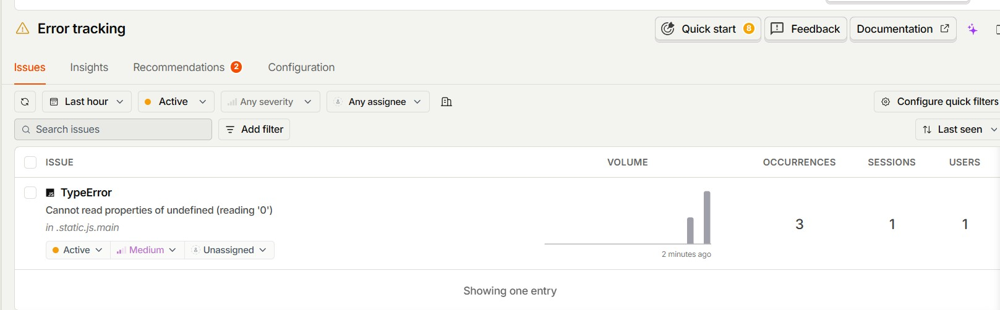
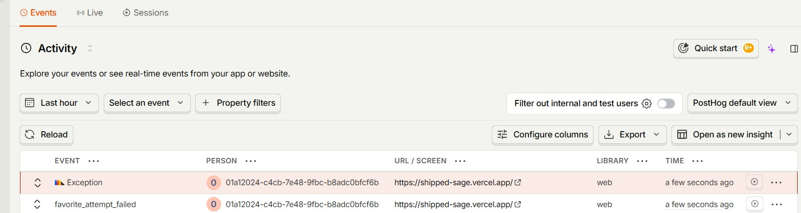
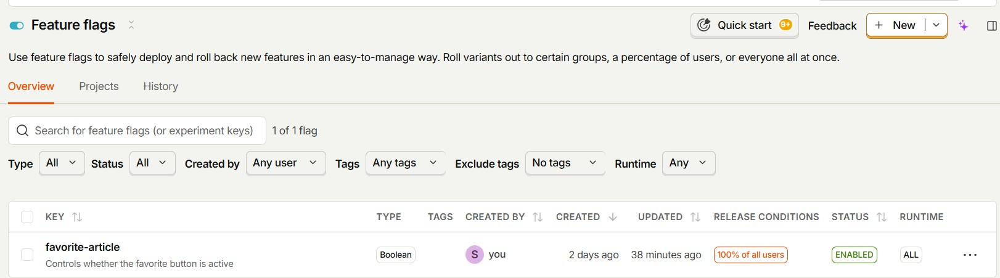

# shipped

Tests gate every PR. Monitoring catches what slips through.

[Live app](https://shipped-sage.vercel.app) · [Run it](#run-it) · [Tests](#whats-tested) · [Notes](#notes-from-the-build)

## How it works

**Before merge**
- Automated Playwright tests run on every pull request.
- A PR can't be merged unless they pass.

**After deploy**
- If an edge case gets missed and a bug reaches production, PostHog records the error and shows how many users hit it.
- A feature flag turns the affected feature off. No need to redeploy.

The bug in this demo was added on purpose, to show this flow.

## What it looks like



*PostHog groups the error and counts who was affected.*



*The failed favorite is also recorded as an event.*



*One switch turns the feature off.*

## Run it

**Stack:** React, Express, Prisma, Postgres (Neon). Frontend on Vercel, backend on Render.

You need Node 22 and a Postgres database URL (a free [Neon](https://neon.tech) database works).

```bash
# backend
cd backend && npm install
# create backend/.env containing: DATABASE_URL="postgresql://..."
npx prisma migrate deploy

# frontend
cd ../frontend && npm install

# tests (Playwright starts both servers itself)
cd ../tests && npm install && npx playwright install chromium
npx playwright test
```

## What's tested

<details>
<summary>Show the tests</summary>

| Test | What it checks | Type |
|---|---|---|
| Core flow | Sign up, publish an article, see it in the feed, edit the profile | Browser |
| Invalid login | Wrong credentials show the right error | Browser |
| Duplicate email | A second sign-up with the same email is rejected | API |
| Empty title | The server rejects an article with no title | API |
| Unauthenticated favorite | Favoriting without logging in returns 401 | API |
| Access control | One user can't edit another user's article | API |
| Concurrent favorites | Two simultaneous favorites count once | API |
| Response headers | Pins the current state of two security headers on the API response | API |

</details>

## Notes from the build

<details>
<summary>Things that save an afternoon</summary>

- PostHog loads from the HTML snippet in `frontend/public/index.html`. The frontend's 2018-era build tool (`react-scripts` 1.x) fails to minify the `posthog-js` npm package.
- CI pins Node 22. The old frontend's dev server doesn't start on Node 24.
- A disabled flag reads as `undefined` in the browser, so the click handler treats anything other than `true` as off. Flags are read at page load, so refresh after toggling.
- The frontend picks its API URL by hostname: `localhost` uses the local backend, anything else uses Render. That keeps CI off the free-tier backend, which sleeps.
- `webServer` in `playwright.config.ts` starts the backend and frontend, so CI needs one command.

</details>

## Credits

Built on the RealWorld "Conduit" example apps by gothinkster: [backend](https://github.com/gothinkster/node-express-realworld-example-app) and [frontend](https://github.com/gothinkster/react-redux-realworld-example-app). See each project's repository for license terms.
